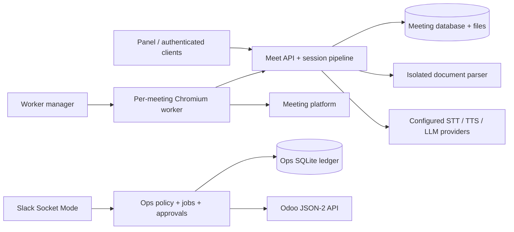

# Katip · openkatip

Katip is an on-premises AI assistant with two independent Python engines. You run
the control plane and store your data on your own server; configured external
speech and language providers still process the data sent to them.

| Product | Included capabilities |
| --- | --- |
| **Katip Meet** | Browser meeting agent for Microsoft Teams, Google Meet and Zoom; Turkish commands, transcription, translation, notes and reports. |
| **Katip Ops** | Slack operations assistant with typed Odoo actions, policy checks, owner approvals and an execution ledger. |
| **Katip Full** | Both engines in this repository, deployed with separate credentials and boundaries. |

Full is a deployment choice. There is no automatic Meet-to-Ops dispatcher;
[the event envelope](engines/ops/EVENTS.md) is a definition for future integration.

## Features

- Live subtitles and translation, chat or spoken replies, summaries, decisions and actions.
- Meeting preparation documents and opt-in PDF presentations with approved start.
- PDF/Word reports, participant-aware meeting access, calendar invitation policies,
  Microsoft 365 integration and approved meeting-note email.
- A Turkish web panel, per-meeting browser workers, isolated document parsing,
  encrypted meeting content when configured, and retention controls.
- Ops jobs for content preparation, pipeline research, GEO measurement and Friday
  review; configurable Claude/OpenAI/DeepSeek routing and owner-only Slack approvals.

Browser platforms change frequently. Admission, captions, guest permissions and
screen sharing depend on the meeting platform and organizer settings.

## Quick start: a single Linux server

Follow [Getting started](docs/getting-started.md) to create `.env`, generate secrets,
set the Docker socket group and configure TLS. Then, from the repository root:

```sh
cp .env.example .env
# Complete the required installation values and secret files first.
docker compose -f docker-compose.isolated.yml --profile build build
docker compose -f docker-compose.isolated.yml up -d
```

The API listens on server loopback port 8000; publish it through your own HTTPS
reverse proxy or authenticated tunnel. Visit `/admin` after configuring the
bootstrap administrator. This Compose file starts Meet, its manager/parser and
PostgreSQL. [Ops setup](docs/ops-engine.md) uses its own Compose/configuration.

## Architecture



The manager holds the Docker socket; workers receive per-meeting capabilities,
not server provider keys. See [architecture](docs/architecture.md) and
[production deployment](docs/deployment.md).

## Screenshots

TODO: add reviewed, anonymized screenshots of the admin panel, live meeting panel
and Ops approval card before a tagged public release. No private screenshots are shipped.

## Configuration and privacy

[Configuration](docs/configuration.md) documents every Meet setting;
[providers](docs/providers.md) explains processing paths and regions. Panel and
calendar trusted-domain lists default to empty and must be set per installation.
Credentials and organization documents belong in installation configuration.

Panel passwords use scrypt; sessions use secure cookies and CSRF checks. Signed
report/panel links are bearer capabilities: anyone with a valid link may use its
scope. Protect them accordingly. See [security](docs/security.md).

Katip posts a configurable Turkish privacy notice when joining. It does not save
raw meeting audio in the normal session pipeline. Transcripts, translations,
documents and requested screenshots can contain personal data. An on-premises
control plane does not imply local AI processing or automatic KVKK/GDPR compliance.
The operator must establish the legal basis, transfers, participant information,
retention and rights-handling process. Biometric recognition is disabled in the
meeting session; legacy voice settings are retained for compatibility.

## Documentation and contribution

- [Türkçe README](README.tr.md) · [Türkçe toplantı rehberi](docs/meeting-agent.md)
- [Admin guide](docs/admin-guide.md) · [Katip Ops](docs/ops-engine.md)
- [Developer guide](docs/developer-guide.md) · [FAQ](docs/faq.md)
- [Contributing](CONTRIBUTING.md) · [Code of conduct](CODE_OF_CONDUCT.md)
- [Report a vulnerability](SECURITY.md)

## License and trademarks

Code and documentation are available under the [MIT License](LICENSE),
Copyright (c) 2026 Verhex. Dependencies retain their own licenses; see [NOTICE](NOTICE).
The **Katip name and logo are not licensed under MIT**. The MIT license grants no
trademark rights or permission to imply endorsement. TODO: publish a trademark
contact and usage policy.
